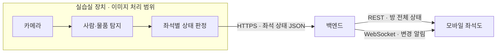

# 시스템 구조

학생이 실습실 화면을 열면 웹은 서버가 보관한 최근 좌석 상태를 읽습니다. 카메라 관측은 학생의 접속과 독립적으로 장치에서 이어집니다.

## 각 파트가 맡는 일

| 파트 | 책임 |
| --- | --- |
| Vision | 카메라 화면에서 좌석별 영역을 지정합니다. YOLO로 찾은 사람·소지품을 해당 좌석에 연결하고 시간에 따른 관측을 모아 상태를 판정합니다. |
| 백엔드 | FastAPI 서버가 장치의 보고를 인증하고 방별 최신 상태를 메모리에 보관합니다. 빈자리 수와 확인 불가 좌석 수를 집계하고, 장치의 연결 상태와 좌석 변경을 웹에 전달합니다. 1분마다 방 요약(좌석별 기록이 아닌 방 단위 숫자)을 SQLite에 남겨 혼잡도 통계를 냅니다. |
| 프론트엔드 | 처음에는 방 전체 상태를 읽어 좌석도를 그립니다. 이후 도착하는 변경 알림을 좌석도와 요약 숫자에 함께 반영합니다. |

세 파트는 같은 방 ID와 좌석 ID를 사용합니다. 예를 들어 Vision의 `A-01`은 카메라 영상 안의 다각형 영역과 연결되고, 웹의 `A-01`은 좌석도 위의 위치와 연결됩니다. 두 좌표계는 용도가 다릅니다. 웹은 좌석 ID를 통해 판정 결과를 해당 위치에 표시할 수 있습니다. [공통 인터페이스](INTERFACES.md)

## 이미지가 머무는 범위

카메라 원본, 좌석 영역을 잘라 낸 이미지(ROI), 좌석 지정에 쓰는 정지 화면은 **장치의 RAM에서만 처리**하는 것이 설계 원칙입니다. 좌석 지정 후 보관하는 값은 방·좌석 ID와 영역 좌표입니다. 서버로 보내는 값은 상태 코드, 관측 시각 등 비영상 데이터입니다. 학생과 관리자 모두 웹에서 좌석도와 숫자로 결과를 확인합니다.

이 원칙을 검증할 때는 장치의 파일·임시 파일·로그·스왑에 이미지가 남는지, 네트워크로 이미지가 나가는지 살펴봅니다. 상태 보고에 포함된 저장 프레임 수는 이때 대조할 지표 중 하나입니다.

## 개발 환경과 운영 장비

노트북과 내장 카메라로 개발하고, 운영 대상은 **Raspberry Pi 5(8GB)와 USB 웹캠**입니다. Vision README에는 Windows 노트북에서 YOLO를 실행했다는 기록이 있습니다. Pi에서의 추론 속도와 정확도는 장비에서 별도로 측정할 항목입니다. 초기 개요의 분석 속도 1~3 FPS와 화면 반영 시간 5~15초는 목표치입니다. [Vision 실행 및 검증 기록](https://github.com/KNUCreaterCrew/vision)

선택적 로컬 VLM은 확인이 어려운 좌석의 ROI만 장치 안에서 다시 검토하는 설계입니다. 검증을 끝내지 못하면 좌석 상태의 유효 기간과 확인 불가 기준을 적용합니다. [좌석 상태 판정 기준](SEAT-STATES.md)
